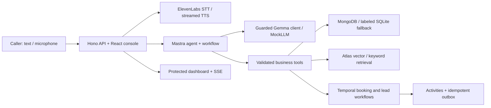

# Ringback

A small-business receptionist for the calls you cannot take. Ringback answers from the owner's business information, proposes real available slots, asks for confirmation, and keeps appointments, messages and follow-through in one workspace. It is built around an interchangeable **Gemma-only** model client, a Mastra agent and typed tools, MongoDB-compatible storage, and Temporal workflows.

**Current state:** working text demo with **MockLLM**, keyword retrieval and a labeled SQLite fallback. Real local Temporal and MongoDB integration tests run here. Live Gemma, ElevenLabs, Atlas Vector Search and a Render deployment have not been verified. Do not treat mock timings or scenario results as model benchmarks. [STATUS.md](STATUS.md) is the final evidence and limitations ledger.


## Quickstart

Requirements: Linux x64/arm64, Node 24, npm, curl and tar. No API key is needed for the honest text demo.

```sh
ONNXRUNTIME_NODE_INSTALL=skip npm ci
npm run setup
npm run build
npm start
```

Open the app on port `3000`. Choose a fictional business and start a conversation. The owner dashboard requires the `ADMIN_TOKEN` generated in the **gitignored `.env.local`**; read it privately in your editor and enter it into the owner login. Never paste it into an issue, screenshot, or shared command. `npm start` supervises a local, file-backed Temporal dev server, worker and web app. It is a demo topology, not production Temporal hosting.

`ONNXRUNTIME_NODE_INSTALL=skip` omits unneeded CUDA downloads; the verified npm package includes the CPU runtime. If a corporate proxy is used, configure its trusted CA; never disable TLS verification. For a local Docker build behind this environment's proxy, see [DEPLOY.md](docs/DEPLOY.md).

The existing checkout is the project; no Git worktree is needed. `npm run dev` runs just the web/API process. `npm run worker` runs a separate worker against `TEMPORAL_ADDRESS`. `npm run doctor` reports missing bindings without revealing values.

## Try a conversation

The seeded businesses are fictional: Copper & Cloud Plumbing, Juniper Moon Salon, and Little Orbit Maths. Use a fictional name and `demo-001` as a phone identifier. Ask “What does a haircut cost?”, then “Book a haircut on YYYY-MM-DD at HH:mm” with a future weekday. Confirm with “yes”. The owner dashboard shows the reservation and its Temporal workflow identifier/status. “I smell gas” at the plumbing business takes the urgent path and honestly reports notification delivery status.

Audio is optional. Without an ElevenLabs key the console provides text and opt-in browser speech, explicitly labeled degraded. With a working key it uses microphone recording, STT, the same agent behavior, and sentence-chunked TTS. Audio support has mocked transport tests; a real spoken booking is still an unmet live criterion.

## Architecture



Models classify caller intent into schema-validated JSON. The application executes tools and renders critical business facts from approved config or tool results. Caller text cannot directly choose a caller identity or bypass slot confirmation. This trades free-form fluency for an auditable booking boundary. The Gemini family is rejected explicitly.

## Environment

`.env.example` contains names only. Place local secrets in `.env.local`; use Render environment settings for deployment.

| Variables | Purpose / behavior |
|---|---|
| `LLM_API_KEY`, `LLM_BASE_URL`, `LLM_MODEL` | Google AI Studio key for Gemma, compatible provider URL, discovered Gemma ID. No key means mock. A non-Gemma model fails startup. |
| `LLM_MODEL_ALT`, `LLM_RPM`, `LLM_TPM` | Optional second Gemma and conservative request/token limits. Requests are serialized globally. |
| `DO_INFERENCE_KEY` | Optional DO inference binding; requires the appropriate `LLM_BASE_URL`. No DO category is claimed. |
| `ELEVENLABS_API_KEY`, `ELEVENLABS_VOICE_ID`, `ELEVENLABS_CHAR_BUDGET` | Optional voice provider, library voice selection and hard character reservation budget. |
| `MONGODB_URI`, `MONGODB_DB` | Persistent MongoDB/Atlas database. Without URI, clearly labeled local SQLite is used. |
| `TEMPORAL_ADDRESS`, `TEMPORAL_NAMESPACE`, `TEMPORAL_API_KEY`, `TEMPORAL_TASK_QUEUE` | External Temporal/Cloud configuration; otherwise supervisor starts a local dev server. |
| `DEMO_TIME_SCALE` | Compress demonstration workflow timers. Keep normal scale for real schedules. |
| `ADMIN_TOKEN`, `ALLOWED_ORIGIN`, `PORT` | Owner/admin access, exact browser origin and web port. |
| `SENTRY_DSN`, `OWNER_WEBHOOK_URL` | Optional scrubbed spans and owner notifications. Outbox preview remains available without a webhook. |
| `EMBEDDING_PROVIDER` | `keyword` is the verified degraded mode. Default attempts an open in-process model; failed weight downloads fall back honestly. |

Additional optional controls and operational limits are documented in [DEPLOY.md](docs/DEPLOY.md), [TEMPORAL.md](docs/TEMPORAL.md), and [GEMMA_SELF_HOSTED.md](docs/GEMMA_SELF_HOSTED.md).

## Verification and evidence

```sh
npm run verify       # strict TS, ESLint, unit/integration tests, production builds
npm run e2e          # Chromium flows + axe + screenshots + video
npm run eval:smoke
npm run eval:full
npm run demo:chaos   # requires a running local Temporal server
npm run doctor
npm run live:verify  # keys-later, checkpointed live evidence
```

For real MongoDB tests: `npm run setup:mongo` uses Docker to extract an official digest-pinned MongoDB binary, then `npm test` starts it via MongoMemoryServer. If the binary is absent, that test is explicitly skipped; SQLite tests still run. Browser tests use system Chromium by default; set `CHROMIUM_PATH` for another installation and install Playwright's FFmpeg for video (`npx playwright install ffmpeg`). See [EVAL.md](docs/EVAL.md) for measured artifacts, scenario counts, confidence intervals, failures and caveats. No live model headline number is available.

Real durability evidence is under `artifacts/chaos/`; real MongoDB concurrency evidence is under `artifacts/mongo/`. Mock regression evidence is under `artifacts/eval/mock-*`. No audio is retained by default. The dashboard's booking value is a sum of configured service prices, not recognized revenue.

## Partner integrations

| Technology | What it does here / code | How to verify / current limit |
|---|---|---|
| **Gemma** | Intent extraction through guarded compatible client, `packages/llm`; refusal of Gemini | `npm run live:verify` once a valid key exists. Present run uses MockLLM. |
| **Mastra** | Agent executes the model run, schema workflow coordinates turns, typed tools isolate business actions; `apps/server/src/mastra-model.ts`, `agent.ts` | Agent/API tests and browser booking exercise this path with MockLLM. |
| **Temporal** | Timers, signals, retries, compensation, booking/lead recovery; `apps/worker` | `npm run demo:chaos`, time-skipping integration tests and history artifact. Verified locally. |
| **MongoDB Atlas** | Official driver, business/caller/appointment storage and vector adapter; `packages/core/src/store.ts`, `retrieval.ts` | Real local MongoDB indexes tested; Atlas provisioning and vector index execution unverified. |
| **ElevenLabs** | Library-voice STT/TTS, sentence streaming and budget; `voice.ts` | Mock transport test verified. Live round trip requires key; no voice category claimed yet. |
| **Render** | Single free-tier container blueprint, `render.yaml`, `Dockerfile` | Local container smoke is distinct from Render deployment. Exact steps in DEPLOY. |
| **DigitalOcean** | Compatible inference path can accept a DO binding | No connected catalog/provisioning tools or inference key were exposed. Not a verified category. |
| **Sentry** | Optional numeric per-turn/stage spans, outbound whitelist; `telemetry.ts` | Captured-envelope canary test passes locally. No external DSN delivery claimed. |

## Privacy, security and durability limits

This is a demonstration, not a medical/emergency dispatch or production telephony service. The microphone console is a browser call; there is no PSTN number. Emergencies create an urgent message and advise appropriate human help. No real SMS/email is sent by the outbox preview. Webhooks have at-least-once transport semantics; receivers should deduplicate their idempotency key.

Transcripts are stored after an AI/consent notice; audio is not stored by default. Hosted Gemma sends caller text to its provider and ElevenLabs receives audio/text when enabled. The code is **designed to** support self-hosted Gemma by changing environment variables; a local Gemma run has not been demonstrated. Do not claim data stays on the machine in hosted mode. Browser speech synthesis depends on the browser/OS voice service and is not a privacy guarantee.

The owner dashboard/admin API requires a bearer token. Caller sessions use separate scoped random tokens, returning identities need their own token, inputs are size-limited, public requests are rate-limited and CORS is restricted. `DELETE /api/callers/:id` requires owner authorization and deletes the caller's stored application records. Temporal history may still retain opaque identifiers until its retention expires; no transcript text is deliberately put in workflow payloads. There is no multi-owner account/RBAC system yet.

Render's free instance can sleep and its filesystem is ephemeral. Local Temporal history and the SQLite fallback may be lost on restart. Configure Atlas as booking source of truth; startup reconciliation restores missing booking workflows idempotently. No paid disk, paid instance, or keep-alive workaround was provisioned. The dev server is suitable only for this demo; use Temporal Cloud or a production cluster for a real business.

## MCP setup and development sources

The requested Render, DigitalOcean, MongoDB and ElevenLabs MCP servers were not available in the execution session. `codex mcp list` returned none. Mastra's standard registration was blocked by read-only platform config; `scripts/read-mastra-docs.ts` successfully calls its installed stdio server instead. The code follows current package docs and official Temporal, Google and ElevenLabs sources, listed in [DECISIONS.md](docs/DECISIONS.md). MCP access never implies possession of raw runtime API keys.

## Demo, trial and publication

- [90-second demo flow](docs/DEMO_SCRIPT.md)
- [First-user kit](docs/FIRST_USER_KIT.md)
- [DEV post draft](docs/POST_DRAFT.md)
- [Build/debugging log](docs/BUILD_LOG.md)
- [Known issues and reproductions](docs/KNOWN_ISSUES.md)

## Credits and assistance

New application code was written for this project. MIT license applies to this repository. Dependencies retain their own licenses: React, Vite, Hono, Zod, Luxon, Mastra, MongoDB driver/MongoMemoryServer, Temporal SDK/CLI, Transformers.js/ONNX, Sentry, Lucide, Playwright and axe. The configured MiniLM embedding model is open source; it was not successfully downloaded in this run. Documentation sources are credited in DECISIONS.

AI-assistance disclosure: this project was implemented and tested with Codex using the owner's brief. The owner must review the implementation, claims and submission before publishing. No first-user interview or live benchmark has been invented.

## Commits after the submission deadline

Any commit made after October 18, 2026, 11:59 PM PDT must be listed here by the owner.

<!-- No post-deadline commits listed. -->
