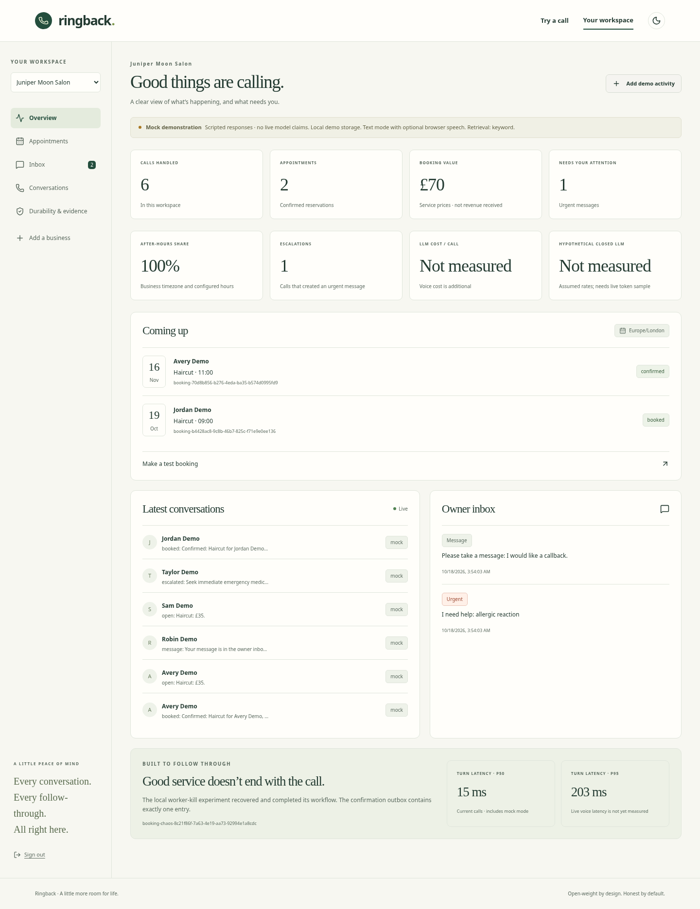
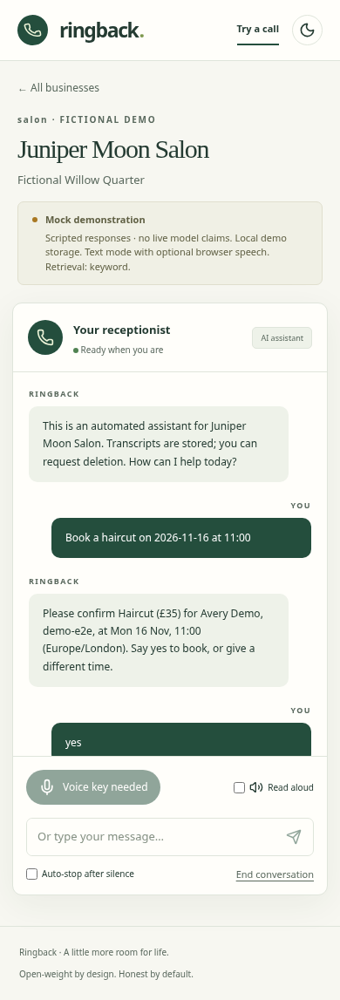

## What I Built

A small-business owner cannot answer every call while cutting hair, fixing a leak or teaching a lesson. Ringback is a receptionist console for that gap: answer from the business's own information, find a real slot, repeat the details, and book only after the caller confirms. The owner gets a diary, conversation feed, messages and the workflow status behind each appointment.

This version is a working **text demonstration with MockLLM**. I built the Gemma and ElevenLabs adapters, but the provider keys were scheduled to arrive after the build. I cannot honestly show a live spoken Gemma booking yet. The demo keeps that limitation visible instead of disguising scripted responses as model output.

## Demo

<!-- OWNER: replace this with a reviewed, publicly hosted demo-video link. -->

Demo video: **PLACEHOLDER — record/review/upload before publishing.**

The demonstration script is in `docs/DEMO_SCRIPT.md`. Start with the fictional salon, ask the haircut price, request a future weekday appointment and confirm it. Open the owner dashboard and inspect the reservation and Temporal workflow identifier. Then test an urgent situation at the fictional plumbing business and watch it enter the owner inbox. This is not a phone-network call or an emergency dispatch service.

## Code

Repository: https://github.com/dhruvvvgg/ringback

The source is MIT licensed. The prepared checkout contains the application and commits; the owner must push/review the repository before this link can be treated as a published release. `README.md` has the quickstart, environment bindings and exact verification commands. `STATUS.md` is the final list of what actually ran and what did not.

## How I Built It

The stack is TypeScript, Hono, React/Vite, a Mastra agent and tools, MongoDB's official driver, and Temporal's TypeScript SDK. A single container serves the app and supervises the local worker and Temporal dev server. The free Render blueprint is supplied, but no Render deployment was possible through the connections exposed in this session.

The most consequential design decision was to make model output an intent proposal, not an instruction to write arbitrary data. Gemma returns schema-validated JSON. A repair retry gets the validation error; a deterministic fallback handles an unrepaired response. The booking engine owns availability. Its tools render prices, times and policies from approved config. Before any reservation is final, the assistant repeats the name, phone identifier, service and exact time and asks for confirmation.

A booking is protected by unique per-resource minute locks, including its buffer. The real MongoDB test accepted **1 reservation out of 40 simultaneous attempts**, then replayed its idempotency key without another appointment. That result is in `artifacts/mongo/concurrency.json`. Separate tests exercise DST and business timezones.

Temporal owns the follow-through. The durability experiment waits until a confirmation is recorded, kills the worker with SIGKILL, restarts it and checks completion. The resulting outbox had **1 confirmation**, with **52 history events** in `artifacts/chaos/run-1792295243380.json`. This proves local worker recovery while the Temporal server survives. It does not prove exactly-once webhook delivery or history persistence after Render discards an ephemeral disk.

Here is the evidence available today. The model-related row is deliberately labeled mock:

| Check | Actual result | Evidence |
|---|---|---|
| Application regression scenarios | 96/96 passed, **MockLLM** | `artifacts/eval/mock-MockLLM-baseline.json` |
| Concurrent MongoDB booking attempts | 1/40 reservation accepted | `artifacts/mongo/concurrency.json` |
| Worker-kill confirmation count | 1 | `artifacts/chaos/run-1792295243380.json` |
| Capped-container observation | Passed; sampled peak 331.2 MiB under the configured cap | `artifacts/deploy/container-memory.json` |
| Live Gemma / spoken booking | **Not measured — keys missing** | `artifacts/live-verify.json` |
| Live cost per call | **Not measured** | `artifacts/cost/cost-model.json` |

The synthetic scenario interval is reported in `docs/EVAL.md`, with the caveat that template variants are correlated. It is not a real-world accuracy estimate. The no-retrieval and no-repair ablations are also mock; identical passing results do not establish a model improvement.

Two debugging stories changed the implementation. First, the earliest mock run misread “What does a haircut cost?” as a booking request because the booking keyword match ran before the price-question match. The scenario harness found it by checking the response and database state. Reordering intent detection fixed the FAQ and Hinglish price cases. Second, a captured Sentry envelope contained a planted caller canary even though the scrub helper passed its unit test. The current Sentry SDK streamed spans by default and bypassed the transaction scrubber. Selecting the tested trace lifecycle and whitelisting outbound fields fixed the actual envelope, not just the helper.

The container test also mattered: the first image completed its booking and then ran out of memory. Compiling the runtime, removing extra loader processes, prebundling workflows and limiting caches brought the repeated capped test into its observed range. These are short demo-load observations, not a production capacity promise.

**What it cannot do yet:** there is no verified live voice booking, Atlas Vector Search result, self-hosted Gemma run or Render URL. Retrieval is keyword-only because the embedding weights could not be fetched. The console has no phone-network integration, real SMS transport or payments. Hindi/Hinglish coverage is narrow. The owner token is a demonstration access mechanism, not a multi-tenant account system. Render's free filesystem is ephemeral, so Atlas and a production Temporal service are prerequisites for a real-business durability claim.

## Why Does Open Innovation Matter?

The open-weight model is the intended conversational brain, and the client refuses Gemini rather than silently swapping in a proprietary model. Provider URL and Gemma ID come from environment variables; discovery filters the actual catalog. That is the basis for a business owner being able to change provider or operate their own inference service.

The privacy claim needs precision. Hosted Google or DigitalOcean inference receives caller text. Hosted ElevenLabs receives audio/text. Self-hosting is **designed into the interface**, but I did not demonstrate it because the official Gemma weight request required authenticated license access. I cannot claim that the deployed demo keeps all data on one machine.

The cost harness compares measured LLM tokens with an explicitly hypothetical closed-API rate. Today its result is null because no live tokens were measured. Eligible free-tier inference is an assumption to verify, not a permanent pricing guarantee. **Voice cost is identical under either LLM and may dominate the total.** Any open-model saving applies to the LLM portion, not the whole call. `npm run live:verify` will produce the missing catalog, evaluation, latency and cost evidence once the owner supplies working keys.

## My Agent Session

I used Codex to implement and test against the supplied brief. The agent kept a phase checklist, decisions, debugging log, measured artifacts and commits. I still need to review the source and claims before submission.

<!-- OWNER: save and embed the actual shareable agent session here. No session link is fabricated. -->

Agent-session embed: **PLACEHOLDER — owner must save and embed the real session.**

## My First User

**PLACEHOLDER — no first-user trial or willingness-to-pay result has happened.**

The trial kit in `docs/FIRST_USER_KIT.md` describes a short onboarding/test-call interview and records yes/no/maybe willingness to pay. Replace this section only after conducting the trial and obtaining permission to quote the participant. Do not turn the fictional demo data into a testimonial.

## Prize Categories

Only integrations with verified work are listed here:

- **Mastra:** its agent/model bridge and typed turn workflow execute the tested receptionist path, including the mock booking flow.
- **Temporal:** real time-skipping lifecycle tests and the worker-kill experiment exercise durable follow-through.

Gemma, ElevenLabs, DigitalOcean, Atlas Vector Search, Render hosting and external Sentry delivery are **not claimed as verified prize categories** in this draft. Local MongoDB concurrency and captured Sentry-envelope scrubbing are useful engineering checks, but do not establish Atlas or external-service delivery. Revisit categories only after the corresponding live evidence exists.
